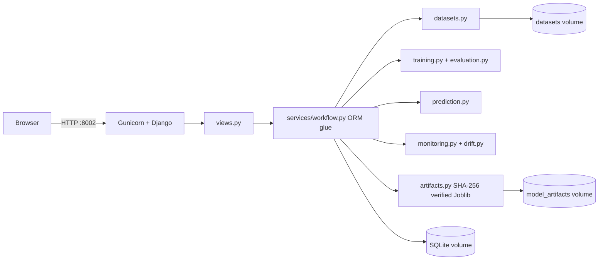

# Model Monitoring Dashboard

Django + scikit-learn app to **upload datasets → train & compare models → serve predictions → monitor latency, drift and (when labels exist) live performance**, packaged with Docker and a Jenkins *Freestyle* CI/CD job.

## ⚠️ Verification status (read first)
This project was generated in a sandbox that had **no Django, no Docker, no Jenkins and no network**.

| Part | Status |
|---|---|
| `automl/services/*` (CSV validation, training of all 9 algorithms, metrics, safe artifact load, prediction, PSI/KS/chi-square drift, monitoring maths) | ✅ **Executed**: `python -m unittest automl.tests.test_ml_services` → 22 tests passed (Python 3.12, scikit-learn 1.8.0, pandas 3.0.2). |
| Django models, hand-written migration, views, forms, templates, settings, management commands, `test_django_app.py` | ⚠️ **Written, byte-compiled, never run.** Expect to fix small issues on first run. |
| Dockerfile, docker-compose.yml | ⚠️ Written, never built. |
| Jenkins Freestyle job (`docs/JENKINS_FREESTYLE.md`) | ⚠️ Written, never run. |
| Pinned versions in `requirements.txt` | ⚠️ numpy/pandas/scipy/scikit-learn/joblib match the tested sandbox; Django 5.2.7, gunicorn 23.0.0, whitenoise 6.9.0, unittest-xml-reporting 3.2.0 are unverified pins. |

**First thing to do on your machine** (confirms migration + Django layer):
```powershell
python -m venv .venv ; .\.venv\Scripts\Activate.ps1
pip install -r requirements-ci.txt
$env:DJANGO_DEBUG="True"
python manage.py check
python manage.py makemigrations --check --dry-run   # must say "No changes detected"
python manage.py test automl                        # all tests
```
If `makemigrations --check` reports changes, run `python manage.py makemigrations automl` and commit the result (the hand-written `0001_initial.py` could not be generated by Django here).

## Run locally (no Docker)
```powershell
$env:DJANGO_DEBUG="True"; $env:ADMIN_USERNAME="admin"; $env:ADMIN_PASSWORD="choose-a-strong-one"
python manage.py migrate
python manage.py ensure_admin
python manage.py runserver 8002      # http://localhost:8002
```
Sign in, then **Datasets → Load bundled sample datasets → Train → Compare → Model Versions (staff) → Set production → Predict**.

## Docker (PowerShell) — http://localhost:8002 (host 8002 → container 8000)
```powershell
Copy-Item .env.example .env            # then edit DJANGO_SECRET_KEY, ADMIN_PASSWORD
docker compose build
docker compose up -d
docker compose ps
curl.exe -fsS http://localhost:8002/health/
docker compose logs -f web             # follow logs
docker inspect --format "{{.State.Health.Status}}" model-monitoring-dashboard
docker compose restart web
docker compose stop                    # stop, keep everything
docker compose exec web python manage.py load_samples
docker compose exec web python manage.py createsuperuser
# Troubleshooting
docker compose config                  # shows resolved config / missing variables
docker compose logs --tail 200 web
docker compose exec web sh
netstat -ano | findstr :8002
docker volume ls                       # mmd_data, mmd_artifacts, mmd_datasets
```
**Never run `docker compose down -v`** – `-v` deletes the persistent volumes (database, datasets, model artifacts). Plain `docker compose down` is safe.

Persistence: SQLite DB → `mmd_data`, Joblib pipelines → `mmd_artifacts`, uploaded CSVs → `mmd_datasets`. Migrations run on container start (`migrate` only adds/alters; it never drops data).

## CI/CD
See [`docs/JENKINS_FREESTYLE.md`](docs/JENKINS_FREESTYLE.md): Freestyle job `model-monitoring-dashboard-freestyle`, 10 Windows-batch steps, smoke test on port 8012, deploy to 8002 with DB backup, health verification and automatic rollback. No Jenkinsfile / Pipeline anywhere.

## Architecture

```
GitHub push ─▶ Jenkins Freestyle ─▶ verify tools ─▶ venv+deps ─▶ check ─▶ migrations check
   ─▶ Django tests ─▶ ML tests ─▶ docker build ─▶ smoke test (:8012) ─▶ deploy (:8002) ─▶ health check
                                                                      └─ fail ─▶ rollback to previous image
```
Service modules are Django-free (testable alone); `workflow.py` is the only layer that touches the ORM.

## ML pipeline in brief
1. **Validate** CSV (size, encoding, rows ≥ 20, headers, target present; classes ≥ 5 rows each).
2. **Split once** 60/20/20 train/validation/test with a fixed seed (stratified for classification); every algorithm uses the identical split → comparisons are fair.
3. **Pipeline** = `ColumnTransformer` (numeric: median impute [+ StandardScaler for LR/KNN/SVC/Linear/Ridge]; categorical: most-frequent impute + one-hot with `handle_unknown="ignore"`) → estimator. Fitted on **train only** ⇒ no leakage. Constant columns are dropped.
4. **Evaluate on the held-out test set**: classification → accuracy, weighted precision/recall/F1, macro F1, ROC-AUC (binary or OvR macro; `–` when not computable), confusion matrix, report; regression → MAE, MSE, RMSE, R².
5. **Persist** with Joblib; the DB stores SHA-256, size, metrics, schema, split, latency and a reference sample (≤500 training rows + their predictions) for drift. A model is **only loaded if its path is inside `model_artifacts/` and its SHA-256 matches** (pickle files can run code).
6. **Best vs production**: "best evaluated" = best primary metric (F1 / RMSE) within a dataset+target; "production" changes only by staff promote/rollback and is audited.

## Monitoring metrics (viva cheat-sheet)
* **Latency**: average, median, P95 (95 % of requests are faster than this) of measured `predict` time.
* **Success/failure rate**: from the prediction log (validation errors and load failures are logged as failed).
* **PSI** = Σ (cur% − ref%)·ln(cur%/ref%); bins = reference deciles. < 0.10 stable, 0.10–0.25 moderate, ≥ 0.25 large shift.
* **KS test** (numeric) and **chi-square** (categorical) give a p-value. A feature is flagged only if effect size (PSI) *and* evidence (p < 0.05) agree; needs ≥ 30 current predictions, otherwise "insufficient data" and no scores are shown.
* **Drift ≠ degradation.** Drift = inputs/outputs changed. Degradation = accuracy/RMSE got worse, measurable **only** after actual labels are added in Prediction History (≥ 30 labels, compared with the test baseline: F1 drop > 0.05 or RMSE rise > 20 %). Without labels the dashboard says so and shows no performance number.

## Docker / Jenkins in one paragraph each
**Docker** packages the app and its exact dependencies into an image; Compose runs it with a port mapping (8002→8000), restart policy, health check and three named volumes so data survives container replacement. **Jenkins Freestyle** is a GUI-configured job: Git checkout → ordered batch steps → the first non-zero exit code stops the build, so a bad commit never reaches the deploy step; the previous image tag is kept for rollback.

## Security notes
Login required for every page except `/health/`; CSRF on all forms; staff-only promote/rollback; uploads limited to `.csv`, size-capped, stored under random names; secrets only from environment; `DEBUG` off by default; non-root container user; Bootstrap and Chart.js load from jsDelivr (pinned versions) — vendor them into `static/` for fully offline installs.
